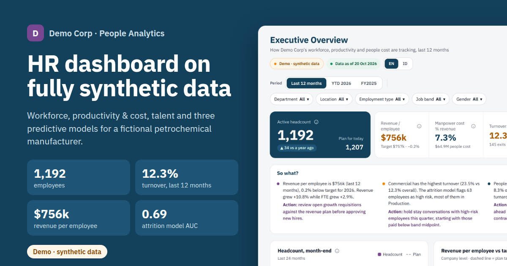

# People Analytics Demo · Demo Corp

**Live dashboard:** see the link in the repository's *About* panel (GitHub Pages).
**All data is synthetic.** Demo Corp is a fictional petrochemical manufacturer (polyethylene and polypropylene, a corporate HQ and three plants, about 1,200 employees). Every person, ID and dollar is generated by a seeded script.



## Why this project

An end-to-end people analytics product built the way it would run inside a company: a data model, reproducible data, metric definitions everyone can read, insight text that changes with the data, and three predictive models that are honest about their limits. It is free to host, has no backend and needs no login.

## What is inside

| Area | Pages | Highlights |
|---|---|---|
| Executive Overview | 1 | Headcount vs plan, revenue per employee vs target, turnover, time-to-fill, attrition risk by department |
| Workforce | Headcount & Department · Attrition · In/Out | 12-month rolling turnover, exit reasons, regretted and early attrition, joiners and leavers by month with anonymous IDs |
| Productivity & Cost | Productivity · Manpower Cost · Cost Ratios · Cost Analysis | Revenue and EBITDA per employee vs target, tonnes per FTE with plant turnarounds, Human Capital ROI, cost by type, cost bridge (headcount vs rate effect), actual vs budget |
| Talent Acquisition | 1 | Funnel, time-to-fill, offer acceptance, cost-per-hire, source effectiveness, requisition aging, quality of hire |
| Talent Management | Performance · Development | KPI-based (70%) + behavior-based (30%) ratings, 9-box, What vs How, training hours and spend, internal fill rate, succession coverage |
| Predictive Insights | 1 | 12-month cost and headcount forecast with what-if sliders, attrition risk (logistic regression), K-Means segments |

Every page has a **So what?** card with two or three findings and a recommended action, computed from the data and the filters. Every metric has an ⓘ button with its formula ([docs/METRICS.md](docs/METRICS.md)). The interface is in English with a Bahasa Indonesia switch.

## Methodology in brief

**Data** ([generator/generate.py](generator/generate.py), [docs/DATA.md](docs/DATA.md)). A month-by-month simulation from January 2023 to today, written in standard-library Python.
- Plant capacity, utilisation and turnarounds drive production. Polymer prices drive revenue, which grows 9–11% a year.
- About 1,080 employees on day one. Each month, everyone has a resignation probability from a logistic score with planted drivers: compa-ratio, months since promotion, tenure, training hours, and high performers paid below midpoint. Terminations follow ratings, and fixed-term contracts are renewed or ended.
- Exits and a headcount plan open requisitions, with realistic time-to-fill, funnels, offer declines and costs.
- Pay follows band midpoints, April merit and March bonus. Annual reviews combine KPI achievement and five behavioral competencies.

Every random draw is keyed by entity and period, so the same seed and date give byte-identical files and history does not change when the date moves forward.

**Validation** ([generator/validate.py](generator/validate.py), [docs/VALIDATION.md](docs/VALIDATION.md)). 75 checks covering:
- **Ranges:** revenue growth 8–12%, manpower cost 6–10% of revenue, turnover 11–15% for every rolling 12-month window, time-to-fill 35–50 days.
- **Consistency:** headcount = previous + joins − exits; the cost table matches employee records.
- **Correlations:** each planted driver is visible in the data.
- **Footprint:** a forbidden-term scan stored as SHA-256 hashes.

**Models** ([models/train.py](models/train.py)), labelled *illustrative model on synthetic data*:
1. **Forecast.** OLS with a trend and 11 month dummies (cost and revenue on the log scale), 80% prediction interval and a 12-month back-test (mean absolute error about 1.4% for cost, 0.9% for headcount). Sliders rescale the baseline relative to the growth the model implies.
2. **Attrition risk.** Logistic regression (IRLS, L2) on 1 January snapshots: tenure, compa-ratio, last rating, months since promotion and training hours. Trained on earlier years and tested on the latest complete year (AUC about 0.69). Scores are prompts for a conversation, not decisions about individuals.
3. **Segmentation.** K-Means, k = 4 (k-means++, 20 restarts, fixed seed) on standardised features, with names from rules on the cluster centres (silhouette about 0.22: people data overlaps).

## Run it yourself

Python 3.9+ only; nothing to install.

```bash
python3 generator/generate.py            # data as of today  (or --as-of 2026-10-20)
python3 models/train.py                  # the three models
python3 generator/validate.py            # 75 checks, writes docs/VALIDATION.md
python3 -m http.server 8000 -d site      # open http://localhost:8000
```

Optional end-to-end browser checks (render every page, mobile overflow, interactions, load time) need Playwright: `pip install playwright && playwright install chromium`, then `python3 tests/check_site.py`.

## Deployment

[.github/workflows/deploy.yml](.github/workflows/deploy.yml) runs on every push and every day at 07:15 WIB (00:15 UTC). Each run:
1. regenerates the data as of today and trains the models;
2. validates the data (deployment stops if the footprint scan fails);
3. publishes `site/` to GitHub Pages.

On the first of each month it also commits a data snapshot. No secrets or paid services are used. Step-by-step guide: [docs/DEPLOY.md](docs/DEPLOY.md).

## Tech choices

- **Plain HTML, CSS and JavaScript:** no framework and no chart library. Charts are hand-built SVG and CSS, sized to their container so the text renders at its true size.
- **Small static payload:** about 240 KB of compressed JSON for the first view. The largest file (review history) loads in the background.
- **Accessibility:** keyboard navigation and visible focus, formula tooltips on focus and tap, motion that respects reduced-motion settings, and no horizontal scrolling from 360 px up.

## Disclaimer

Demo Corp, its people and its numbers are fictional and do not describe any real company.
